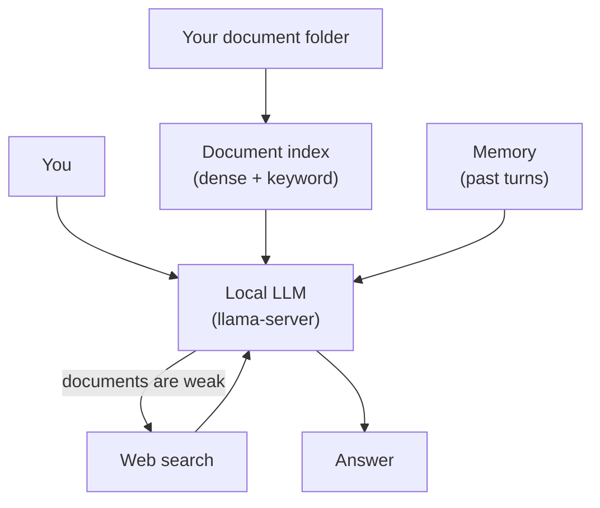
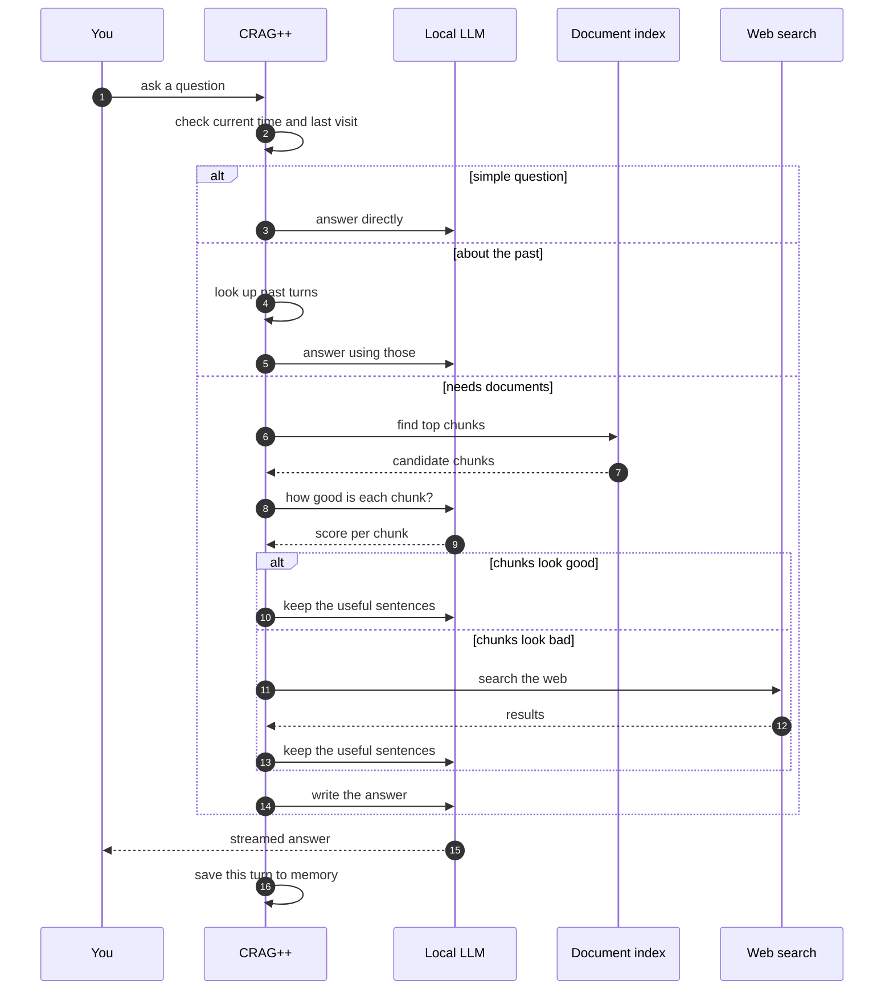
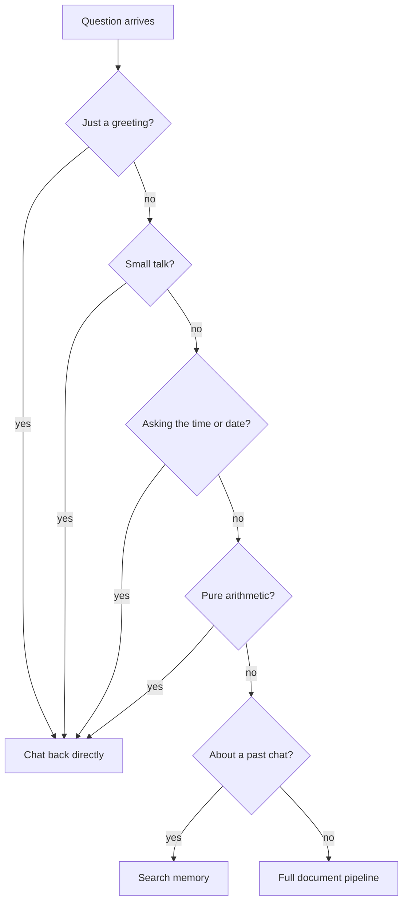
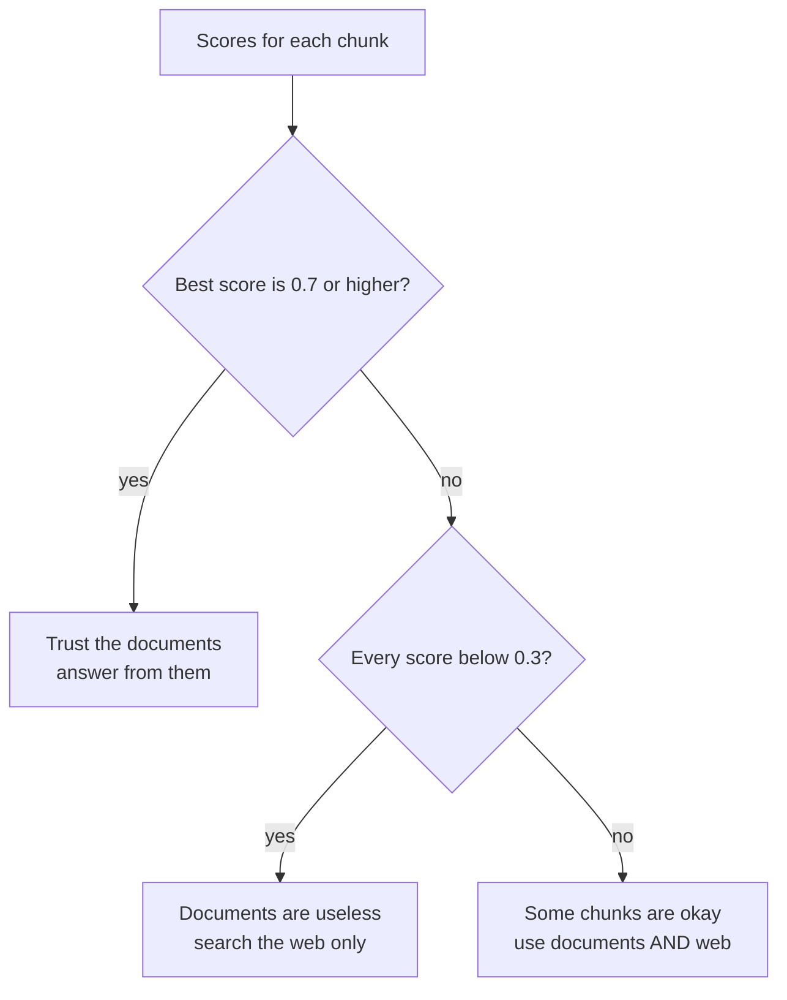

# CRAG++ — Self-Corrective RAG with Memory

Ask a question. CRAG++ finds relevant documents, checks how useful they really
are, and if they are not good enough, it searches the web instead. Then it
writes an answer that stays grounded in whatever it actually found.

It runs on the same local `llama-server` as the
[ULTRON voice assistant](https://github.com/hacktivist211/tts_loop_agent).
No second model, no extra GPU memory, no Ollama.

It also remembers past conversations, so you can ask "what did we talk about
last Tuesday" and get a real answer with a timestamp.

---

## Quickstart

```bash
# 1. install
pip install -r requirements.txt

# 2. start llama-server somewhere (shared with the voice stack):
#    ./start_llama.sh    from the tts_loop_agent repo

# 3. point CRAG++ at it
echo 'LLAMA_SERVER_URL=http://127.0.0.1:8080' > .env
echo 'LLM_MODEL=Qwen3.5-4B'                   >> .env
chmod 600 .env

# 4. add documents and chat
python main.py --ingest-dir ~/Documents/papers
```

---

## Contents

1. [What it does](#1-what-it-does)
2. [How the pieces fit](#2-how-the-pieces-fit)
3. [What happens on a question](#3-what-happens-on-a-question)
4. [Which questions skip the heavy path](#4-which-questions-skip-the-heavy-path)
5. [How good answers are decided](#5-how-good-answers-are-decided)
6. [Memory](#6-memory)
7. [Files](#7-files)
8. [Install](#8-install)
9. [Commands and options](#9-commands-and-options)
10. [Testing](#10-testing)
11. [Problems and fixes](#11-problems-and-fixes)
12. [Relation to ULTRON](#12-relation-to-ultron)

---

## 1. What it does

- **Finds documents** for your question (semantic + keyword search).
- **Grades them** with the LLM. Bad ones get dropped.
- **Falls back to web search** if the local documents are not good enough.
- **Writes a grounded answer** and streams it out word by word.
- **Remembers every turn** with a timestamp, so follow-ups like
  "what did I ask yesterday" actually work.

It is not a web crawler. You point it at folders of `.txt`, `.md` and `.pdf`
files. Web search is only a per-question fallback.

---

## 2. How the pieces fit



Four things live around the LLM:

- **Document index** — searchable chunks of your files.
- **Memory** — a log of every past question and answer, with a timestamp.
- **Web search** — DuckDuckGo first, Tavily as a backup.
- **The LLM itself** — grades documents, cleans them up, and writes the answer.

Everything talks HTTP to the same `llama-server` process. There is one model
in memory, not three.

---

## 3. What happens on a question



Roughly: **find → judge → clean → answer → remember.**

Each step is a small, separate LLM call. They are short and run one after
the other on the same server.

---

## 4. Which questions skip the heavy path

Not every question needs retrieval. Some are obvious.



| Type | Example | What happens |
|---|---|---|
| Greeting | "hi", "thanks" | Reply directly |
| Small talk | "how are you" | Reply directly |
| Identity | "who are you" | Reply directly |
| Current time | "what time is it" | Reply with the clock |
| Arithmetic | "2 + 2" | Answer without retrieval |
| Past chat | "what did we discuss last week" | Search memory |
| Everything else | anything factual | Full document pipeline |

This is a simple rule matcher, not an LLM call. It saves time and tokens on
questions that clearly do not need a knowledge base.

If you want every question to go through the full pipeline, set
`CRAG_QUERY_ROUTER=0`.

---

## 5. How good answers are decided

Every retrieved chunk gets a score between 0.0 and 1.0 from the LLM. Then a
simple rule picks a path:



| Verdict | Meaning | What gets used |
|---|---|---|
| CORRECT | At least one chunk scored 0.7+ | Local documents only |
| AMBIGUOUS | Nothing is great, nothing is terrible | Local documents + web, web pushed up |
| INCORRECT | Everything scored below 0.3 | Web only |

The three thresholds are `0.7` (good enough) and `0.3` (useless). You can
change them in `evaluator_router.py` if you want a stricter or looser filter.

**One more safety net** — if web search also returns nothing, the answer
carries a warning that says "this is general knowledge, not verified." The
model is instructed to say so instead of guessing.

---

## 6. Memory

Every turn is stored with:

- The question and answer.
- The verdict (CORRECT / AMBIGUOUS / INCORRECT).
- A timestamp, weekday, and time of day.

Retrieval blends keywords with **how recent the turn is**. A turn from today
counts more than a turn from three weeks ago, but nothing is ever deleted.

```
score = keywords × 0.72   +   how_recent × 0.28
```

"How recent" halves every 14 days. That means a conversation from last month
still turns up if the keywords match, it just needs to match a bit better.

**Date-aware lookups** work too. If the question contains "yesterday",
"last week", "3 days ago", "in January", or a weekday name, CRAG++ first
narrows to that date range, and only falls back to keyword search if the
range comes up empty.

Two files, two jobs:

| File | What it stores | Who owns it |
|---|---|---|
| `iris_memory/temporal_memory.db` | Every turn, with timestamps | `temporal_memory.py` |
| `memory.db` | Durable personal facts | `memory_store.py` |

The two are intentionally separate. The episodic store is a conversation log;
the personal store is a knowledge base about you.

You can also turn the log into **PNG image pages** if you want a human-readable
archive (`CRAG_VISUAL_ARCHIVE=1`, on by default). No OCR ever runs during
answering, so this costs nothing at query time.

---

## 7. Files

| File | What it does |
|---|---|
| `main.py` | Interactive chat loop and commands |
| `evaluator_router.py` | Grades chunks, cleans them up, runs web fallback |
| `retrieval.py` | Document index (semantic + keyword) and ingestion |
| `generator.py` | Builds the prompt and streams the answer |
| `temporal_memory.py` | Stores every turn, gives back the past ones |
| `tool_runtime.py` | Shared HTTP stream reader (also used by ULTRON) |
| `iris_config.py` | Reads `.env`, holds settings |
| `tavily_tool.py` | Web search (DuckDuckGo first, Tavily second) |
| `memory_store.py` | Durable personal memory |
| `memory_import.py` | Imports ChatGPT / Claude / Gemini / text exports |
| `test_streaming.py` | Offline test for the shared HTTP reader |
| `requirements.txt` | Dependencies (no voice stack) |
| `README.md` | This file |

Files `tool_runtime.py`, `tavily_tool.py`, `memory_store.py`, `memory_import.py`
are optional for a bare `main.py` run, but they are needed once you want
tools or the personal memory commands.

`test_streaming.py` is included because `generator.py` streams through
`tool_runtime.py`. If streaming ever breaks, this test fails before you notice.

---

## 8. Install

You need:

- Python 3.11 (3.14 does not have a CUDA torch wheel).
- A running `llama-server`. The `start_llama.sh` from the ULTRON repo works.
- Optional: a Tavily API key if you want reliable web search.

```bash
git clone https://github.com/hacktivist211/modern-crag.git
cd modern-crag
pip install -r requirements.txt

cat > .env <<'EOF'
LLAMA_SERVER_URL=http://127.0.0.1:8080
LLM_MODEL=Qwen3.5-4B
CRAG_EMBED_DEVICE=cpu
# TAVILY_API_KEY=tvly-...        # optional
EOF
chmod 600 .env

# sanity check
python -c "import tool_runtime; print('UP' if tool_runtime.server_ok() else 'DOWN')"
```

If you have no GPU at all, use the CPU torch wheel instead:

```bash
pip install torch==2.6.0 --index-url https://download.pytorch.org/whl/cpu
```

The document index uses bge-m3 embeddings on CPU by default, so the pipeline
never competes with the LLM for GPU memory.

---

## 9. Commands and options

```bash
python main.py --help
```

Common starting points:

```bash
# chunk a folder of documents
python main.py --ingest-dir ~/Documents/papers

# re-scan only new or changed files
python main.py --sync

# wipe the index and start fresh
python main.py --reset

# retrieve more chunks per question
python main.py --k 12 --ef 128

# quieter output
python main.py --quiet
```

Inside the chat:

| Command | What it does |
|---|---|
| `/menu` | Open the "add documents" menu |
| `/stats` | Show chunk count, turn count, database size |
| `/memory` | Show the last 10 turns with timestamps |
| `/forget last` | Delete the last stored turn |
| `/forget all` | Delete all turns |
| `exit` or `quit` | Shut down cleanly |

On startup the app prints one line about the server status, then a short
summary of how many chunks and turns it already knows.

---

## 10. Testing

| Command | Needs a server? | Expected result |
|---|---|---|
| `python test_streaming.py` | no | 49 of 49 pass in under a second |
| `python -c "import main"` | no | imports cleanly |
| `python -c "import tavily_tool, memory_store, memory_import"` | no | imports cleanly |
| `python main.py --reset --no-menu` | no | creates `iris_memory/temporal_memory.db` |

Running `python main.py` without a server is also fine — it prints a clean
warning, one friendly error, and returns to the prompt. It does not crash.

---

## 11. Problems and fixes

| What you see | Why | Fix |
|---|---|---|
| "llama-server is not answering" | server not running | start it first |
| `embeddings 404` | server started without `--embeddings` | add the flag |
| `HTTP 400 Pooling type 'none'` | server started without `--pooling mean` | add the flag |
| `CUDA error: out of memory` at start | vision module auto-loaded | add `--no-mmproj` |
| `embedding model mismatch` | changed embedding model | `python main.py --reset` then re-ingest |
| "duckduckgo returned nothing" | DDG blocked on your network | set `TAVILY_API_KEY` in `.env` |
| Only "thinking", no answer | reasoning phase consumed the budget | unset `IRIS_ENABLE_THINKING` |
| "could not store the turn" | SQLite locked | check `iris_memory/temporal_memory.db-wal` |

---

## 12. Relation to ULTRON

CRAG++ shares eleven files with the
[`tts_loop_agent`](https://github.com/hacktivist211/tts_loop_agent) repo:

`iris_config.py`, `tool_runtime.py`, `temporal_memory.py`, `tavily_tool.py`,
`memory_store.py`, `memory_import.py`, `evaluator_router.py`, `generator.py`,
`retrieval.py`, `main.py`, `test_streaming.py`.

The voice assistant already contains everything here plus the mic and TTS
layers. If you only want one repo, use ULTRON. CRAG++ exists so you can run
the research pipeline on its own, without pulling in torch and pykokoro.

**Running both at once** is fine. They share one `llama-server`. Voice turns
and CRAG turns queue behind each other one at a time, but neither starves.

**Memory files stay separate:**

| File | Owner |
|---|---|
| `memory.db` | ULTRON (durable personal facts) |
| `iris_memory/temporal_memory.db` | CRAG++ (conversation log) |
| `crag_vector_store/` | CRAG++ (document index) |
| `visual_memory/` | CRAG++ (optional PNG archive) |

No component writes another component's store.

---

## License

See [LICENSE](LICENSE).
