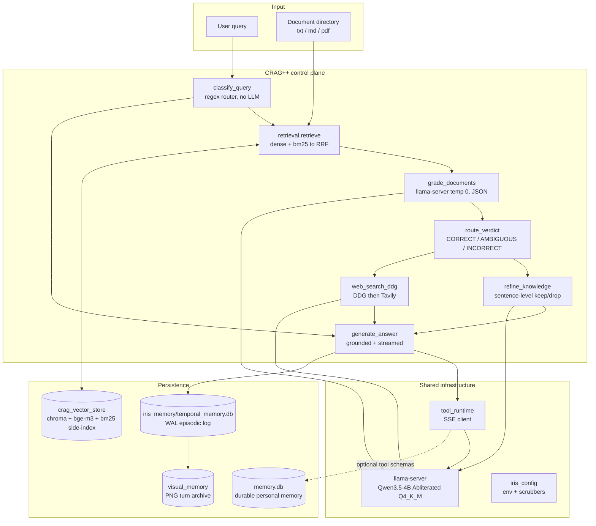
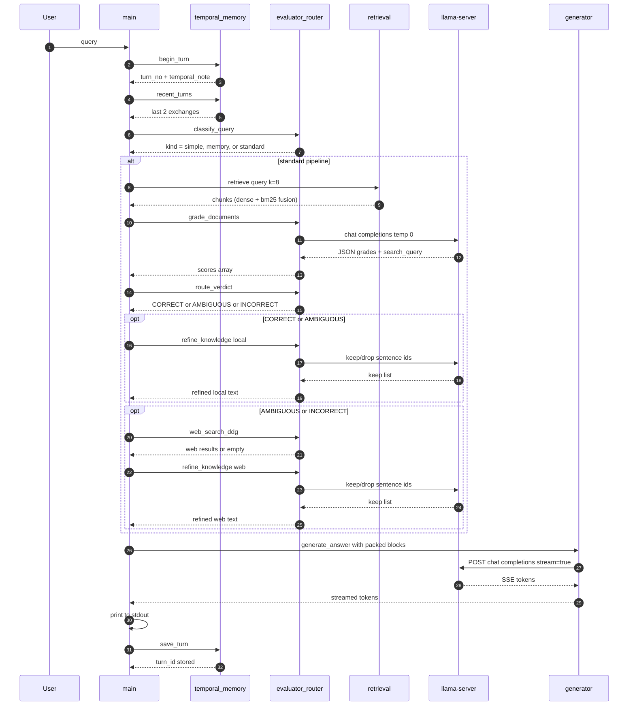
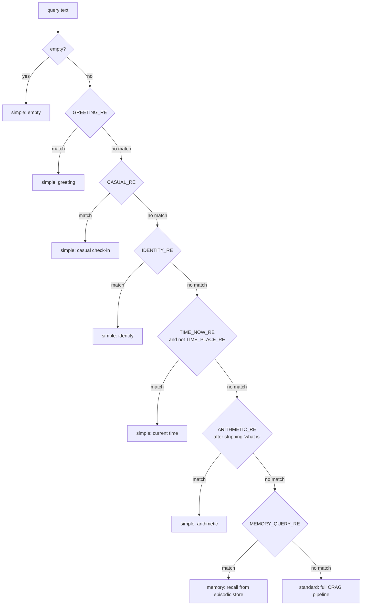
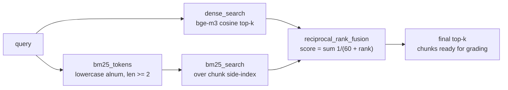
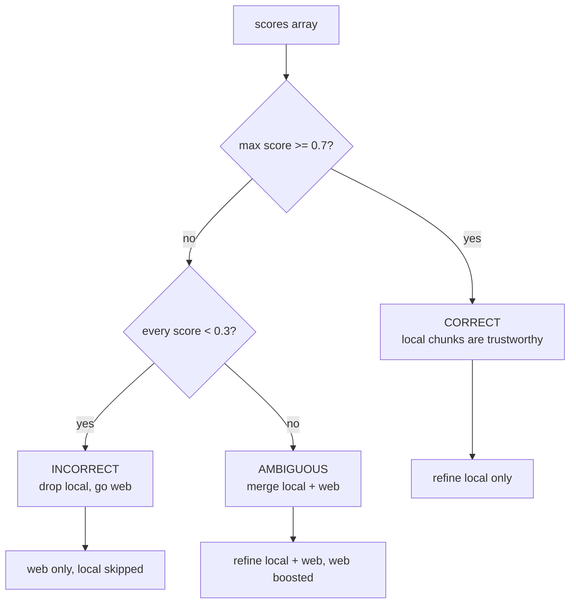
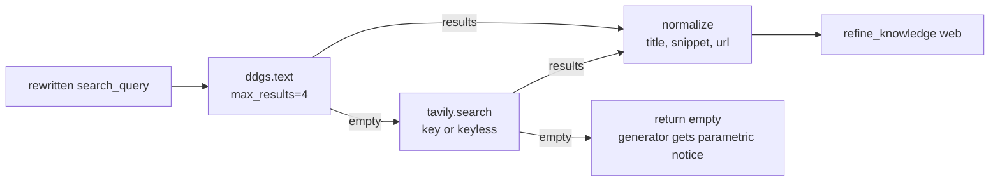
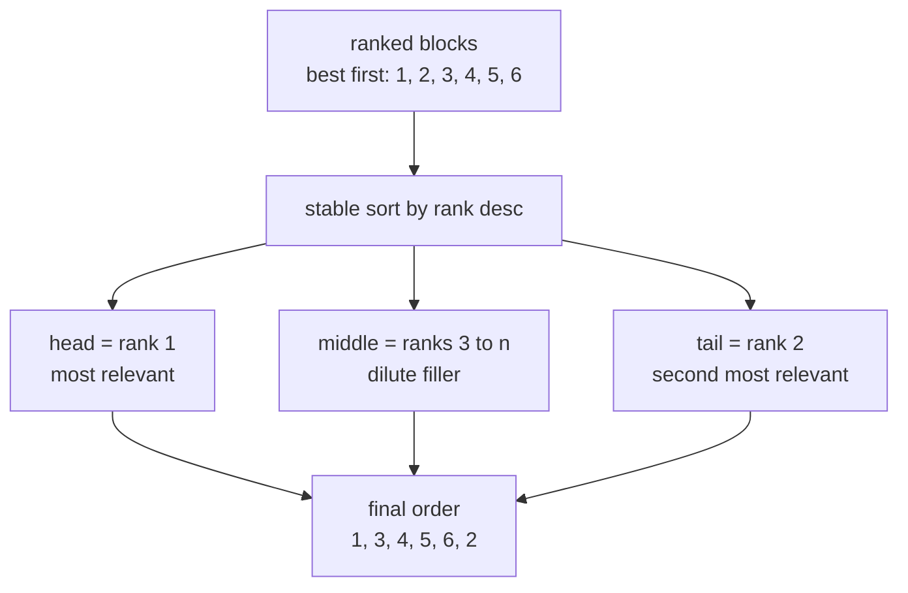
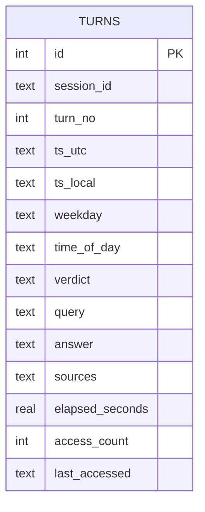
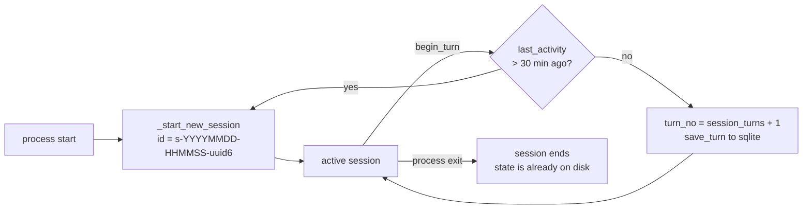

# CRAG++ — Self-Corrective RAG with Temporal Memory

A local-first, self-corrective retrieval-augmented generation pipeline that
runs on top of **llama.cpp `llama-server`** — the *same* server that powers the
[ULTRON voice assistant](https://github.com/hacktivist211/tts_loop_agent).
Zero extra VRAM, zero second model, zero Ollama.

`CRAG++` retrieves (dense + BM25 hybrid), grades every chunk with the LLM,
routes on a CORRECT/AMBIGUOUS/INCORRECT verdict, refines to the useful
sentences, falls back to a live web search when local knowledge is
insufficient, and streams a grounded answer — while an episodic memory layer
tracks time and conversations so follow-ups work naturally.

---

## Quickstart

```bash
# 1. install (Python 3.11)
pip install -r requirements.txt

# 2. start llama-server elsewhere (shared with the voice stack):
#    ./start_llama.sh                # from tts_loop_agent, or your own launcher
#    required flags: --jinja --embeddings --reasoning off --no-mmproj

# 3. optional: point the CRAG embeddings to your backend
cat > .env <<'EOF'
LLAMA_SERVER_URL=http://127.0.0.1:8080
LLM_MODEL=Qwen3.5-4B
CRAG_EMBED_DEVICE=cpu
# TAVILY_API_KEY=tvly-...        # optional; keyless fallback otherwise
EOF
chmod 600 .env

# 4. chunk a directory + chat
python main.py --ingest-dir ~/Documents/papers

# or, if you already have a knowledge base:
python main.py
```

---

## Table of Contents

1. [What CRAG++ is (and is not)](#1-what-crag-is-and-is-not)
2. [System architecture](#2-system-architecture)
3. [The corrective pipeline, step by step](#3-the-corrective-pipeline-step-by-step)
4. [Query routing](#4-query-routing)
5. [Retrieval internals](#5-retrieval-internals)
6. [Grading and verdict routing](#6-grading-and-verdict-routing)
7. [Knowledge refinement](#7-knowledge-refinement)
8. [Web fallback](#8-web-fallback)
9. [Context packing and generation](#9-context-packing-and-generation)
10. [Temporal episodic memory](#10-temporal-episodic-memory)
11. [Session lifecycle](#11-session-lifecycle)
12. [File map](#12-file-map)
13. [Installation](#13-installation)
14. [CLI reference](#14-cli-reference)
15. [Configuration](#15-configuration)
16. [Testing](#16-testing)
17. [Troubleshooting](#17-troubleshooting)
18. [Design guarantees](#18-design-guarantees)
19. [Relationship to ULTRON](#19-relationship-to-ultron)

---

## 1. What CRAG++ is (and is not)

**It is:**

- A **self-corrective RAG control plane**. Every retrieved chunk is graded; low-quality chunks are dropped; misdirected retrieval falls back to a live web search; the answer is grounded in whatever survives.
- A **temporal episodic memory**. Every turn is stored with a session id, a local timestamp, weekday, time-of-day and elapsed time. Retrieval blends keyword overlap with an exponential recency decay so recent context outweighs stale context without ever deleting data.
- A **single-server** design. All LLM calls — grading, refinement, query rewriting, generation — go to the same llama-server at temperature 0 (control plane) or 0.7 (generation). One set of weights in VRAM, one process to keep alive.
- A **thin, deterministic router** in front of the expensive path. Greetings, casual questions, identity questions, current-time questions and pure arithmetic skip retrieval entirely; memory-reference questions skip grading; everything else goes through the full pipeline.

**It is not:**

- A general web-crawling pipeline. Ingestion is directory-based (`.txt`, `.md`, `.pdf`); the web fallback is per-query.
- A multi-user service. One SQLite file, one Chroma collection, one process.
- A voice assistant. The mic/TTS layer lives in `tts_loop_agent` (see §19).

---

## 2. System architecture



Every call that touches the LLM goes through the same server. `tool_runtime.stream_completion` is the shared SSE transport (also used by ULTRON), which means the decoder correctness proven in `test_streaming.py` applies to CRAG generation too.

---

## 3. The corrective pipeline, step by step



The control plane is deliberately **serial**: grading, refinement and generation each wait for the previous response. They are short (typically 100–800 ms) and use the same server at `--parallel 1`, so queuing them one after another avoids interleaving with ULTRON’s voice turns in the same process group.

---

## 4. Query routing

Before any retrieval runs, a regex classifier decides whether the query is worth the expensive path. This is pure Python — no LLM call, no tokens spent.



| Kind | Trigger examples | What runs |
|---|---|---|
| `simple` | “hi”, “how are you”, “who are you”, “what time is it”, “2+2” | Only generation with a TIME block; no retrieval, no grading |
| `memory` | “do you remember”, “last time we discussed”, “what did I ask about”, “conversation history” | `temporal_memory.recall(query)` — window-based if the query has a date expression, else keyword + recency |
| `standard` | Everything else | Full control plane (§3) |

The router is disabled by setting `CRAG_QUERY_ROUTER=0`, which forces every query down the full path (useful for benchmarking).

The regex patterns are conservative on purpose: `TIME_NOW_RE` alone won’t match “what time is it in Tokyo” because `TIME_PLACE_RE` catches the prepositional place phrase, sending it down the standard path where web search can actually help.

---

## 5. Retrieval internals

Retrieval is a two-stage hybrid: dense embeddings for semantic similarity, BM25 for exact keyword matches, fused with **Reciprocal Rank Fusion** (`RRF_K=60`).



**Dense side** — `retrieval.GpuEmbeddings` calls `sentence-transformers` with `BAAI/bge-m3`, L2-normalized, on device `CRAG_EMBED_DEVICE` (default `cpu`, so the pipeline never evicts the LLM from a 6 GB card). Vectors land in `crag_vector_store` (Chroma, HNSW cosine, `search_ef=64` by default).

**Sparse side** — `_bm25_search` runs against an in-memory index of the same chunk collection, rebuilt lazily whenever the chunk count changes. Parameters:

- `BM25_K1 = 1.5` (term saturation)
- `BM25_B = 0.75` (length normalization)
- `SPARSE_CANDIDATE_FACTOR = 3` (bm25 returns 3× the requested k to feed the fusion)

The BM25 index is capped at `BM25_MAX_DOCS=20000` — beyond that, `HYBRID_RETRIEVAL=0` is the recommended override.

**Fusion** — chunks are keyed by their text; a chunk found by both retrievers accumulates score and floats to the top. A strong keyword-only hit can still displace a weak dense hit, which is what rescues lookups on names, IDs and error codes.

**Ingestion** — `VectorEngine.ingest_directory()` walks the directory, computes a per-file `(mtime, size)` hash into `crag_vector_store/manifest.json`, and skips files that haven’t changed. New or modified files re-chunk and re-embed; deleted files have their chunk ids removed from Chroma. Chunks are produced by `RecursiveCharacterTextSplitter` at `CHUNK_SIZE=950` with `CHUNK_OVERLAP=159` (a 17% overlap, chosen so cross-sentence references survive the split). PDFs are parsed via `PyMuPDFLoader`; anything else via `TextLoader(autodetect_encoding=True)`.

---

## 6. Grading and verdict routing

The grader is the corrective core. One LLM call per query, temperature 0, strict JSON output:

```json
{"grades": [{"id": 1, "score": 0.0}, {"id": 2, "score": 0.85}],
 "search_query": "short keyword web search"}
```

The `search_query` field is written **at grading time**, so if the pipeline ends up needing the web fallback it uses a query the model already optimized for retrieval — no second LLM round trip.

Robustness:

- If the JSON is malformed, a **text fallback prompt** asks for comma-separated scores; the response is parsed by `_parse_score_list`.
- If both attempts fail, all chunks get a neutral `0.5` and the pipeline proceeds with the `AMBIGUOUS` branch — the user still gets an answer, just not a graded one.
- Scores are clamped to `[0.0, 1.0]` and defaulted to `0.5` for missing ids.

**Verdict** — `route_verdict(scores, upper=0.7, lower=0.3)`:



| Verdict | Context blocks assembled |
|---|---|
| `CORRECT` | Local refined at rank 3.0 |
| `AMBIGUOUS` | Local refined at rank 2.4 **and** web refined at rank 2.8 |
| `INCORRECT` | Web refined at rank 4.2 (top of the pack) |

Rank values feed the lost-in-the-middle packer in §9 — a rank of 4.2 pushes web evidence to the head of the context, where the model attends most.

---

## 7. Knowledge refinement

Before a chunk reaches the generator it passes through a sentence-level filter. The refiner splits every candidate into sentences (`.!?` plus newline), numbers them, and asks the LLM which to keep:

```json
{"keep": [1, 4, 7]}
```

Same fallback ladder as the grader:

- JSON parse fails → text prompt asking for comma-separated ids.
- Text parse fails → keep every sentence (do not lose information silently).
- Keep set is empty → return empty string (signal “nothing relevant” to the caller).

`MAX_REFINE_SENTENCES=50` caps how many sentences go in — beyond that the request gets expensive and the model’s judgement degrades. Long sentences are truncated at 100000 characters (effectively not truncated — the cap exists only to guard against pathological PDFs).

The refiner is called **once per source** — local chunks first, then web results — so a bad local refinement doesn’t prevent the web fallback from working.

---

## 8. Web fallback

When the local knowledge base is insufficient, `web_search_ddg()` runs:



- **DuckDuckGo** (`ddgs` package) is the primary — no key required. Two attempts with an 0.8 s gap between them, per `_ddg_search`.
- **Tavily** is the fallback. If `TAVILY_API_KEY` is set, `tavily_tool.search` uses the SDK; otherwise it hits the REST endpoint with `X-Tavily-Access-Mode: keyless`.
- **Empty on both** → the pipeline injects a **parametric-fallback notice** into the context block so the generator knows to qualify its answer instead of inventing facts.

Every web result is bounded before it reaches the model: title ≤ 200 chars, URL ≤ 300, snippet ≤ 400 (`tavily_tool._normalize`). This prevents a single verbose source from crowding out the rest of the context.

The banner of the CLI warns explicitly when DuckDuckGo returns nothing:

> `[crag] duckduckgo returned nothing. if this keeps happening it is likely blocked on your network: get a free key at tavily.com, pip install tavily-python, and set TAVILY_API_KEY`

---

## 9. Context packing and generation

**Lost-in-the-middle mitigation.** Long-context models attend most to the beginning and end of the prompt. `generator.pack_context_blocks()` reorders blocks so the top-ranked block sits at the head and the second-ranked block sits at the tail:



With fewer than 3 blocks the order is preserved; ties fall back to their original insertion order.

**Prompt structure** (`generator.build_messages`):

```
<<<TIME_BEGIN>>>
{current time, session info, elapsed since last interaction}
<<<TIME_END>>>

<<<QUESTION_BEGIN>>>
{user question}
<<<QUESTION_END>>>

<<<CONTEXT_BEGIN>>>
[SOURCE 1: local documents]
{refined text}
[SOURCE 2: live web results]
{refined text}
...
<<<CONTEXT_END>>>

Context status: VERIFIED CONTEXT | MEMORY | DIRECT | PARAMETRIC FALLBACK

<<<QUESTION_BEGIN>>>
{user question}
<<<QUESTION_END>>>

Answer the question now, following every rule above.
```

The question appears **twice** — before and after the context — so both primacy and recency positions carry the task description.

**Context status** — determines the answering discipline:

| Status | Meaning |
|---|---|
| `VERIFIED CONTEXT` | Grounded in retrieved or web evidence |
| `MEMORY` | Answering from the episodic store; cite timestamps naturally |
| `DIRECT` | Casual conversation or a time question; no disclaimers |
| `PARAMETRIC FALLBACK` | Must explicitly say the answer is unverified general knowledge |

**Generation** — `generate_answer` streams through `tool_runtime.stream_completion`, which means:

- SSE decoding is byte-level incremental (proven by `test_streaming.py`).
- `reasoning_content` and `<think>` blocks never reach stdout, even if `IRIS_ENABLE_THINKING=1` is set elsewhere.
- Empty responses surface a friendly retry message instead of a traceback.

Backend selection (`generator.py`): `CRAG_BACKEND=llamaserver` (default) sends everything to `LLAMA_SERVER_URL`. `CRAG_BACKEND=ollama` is an explicit opt-in; the `ChatOllama` import happens lazily so the default path never requires Ollama or langchain to be installed.

---

## 10. Temporal episodic memory

Every turn — query, verdict, answer, elapsed time — is persisted to SQLite in WAL mode. A background daemon thread also renders each turn to PNG for a human-readable archive; **no OCR runs at inference**, so the archive costs zero VRAM and zero latency.



**Retrieval** (`temporal_memory.search`) blends keyword overlap with an exponential recency decay:

```
score = 0.72 · overlap + 0.28 · 0.5^(age_days / 14)
```

- `overlap` — normalized term intersection; query terms weighted 1.6×, answer terms 1.0×.
- `age_days` — `now - parsed_ts` in days; `RECENCY_HALF_LIFE_DAYS=14` gives soft forgetting.
- Rows below `MEMORY_MIN_SCORE=0.32` are dropped so unrelated history never crowds the context.
- Access counts and `last_accessed` are updated on every hit — the data model supports future frequency-aware ranking without schema changes.

**Recall with temporal windows** (`temporal_memory.recall`). If the query contains a date expression, retrieval narrows to a date range first:

| Phrase | Window |
|---|---|
| `today` | today → today |
| `yesterday` | yesterday → yesterday |
| `this week` | Monday → today |
| `last week` | last Monday → last Sunday |
| `this month` | month start → today |
| `last month` | previous month start → previous month end |
| `3 days ago`, `2 weeks ago`, `1 month ago` | that single day |
| `last tuesday` | previous Tuesday |
| `in january`, `in march 2024` | entire month |

If the range has results, they are returned (and access-marked). If it is empty, retrieval falls back to `search(query)` with no hard window — so “what did we talk about last Tuesday” never returns nothing just because the conversation actually happened Wednesday.

**Persistence hygiene**

- `MEMORY_DB_PATH` defaults to `iris_memory/temporal_memory.db`. A legacy `iris_memory/memory.db` from an older run is **copied** (never moved, never deleted) on first start.
- The episodic store is intentionally distinct from `memory.db` (durable personal memory, owned by `memory_store.py`). The memory map is documented in `iris_config.py` and §19.
- PNG archive under `visual_memory/YYYY/MM/DD/<timestamp>_<session>_turn<nnn>_p<n>.png`. If Pillow isn’t installed, the archive is silently disabled and everything else keeps working.

---

## 11. Session lifecycle



Session rules:

- A fresh process always starts a new session (`_start_new_session` in `TemporalMemory.__init__`).
- Mid-run, if more than `CRAG_SESSION_IDLE_MINUTES=30` has elapsed since the previous turn, the session is rolled over automatically.
- `last_interaction()` reads the most recent row from disk and reports the humanized delta; `build_temporal_context()` weaves that into the prompt so the model can say “welcome back, it’s been 3 days” when it genuinely fits.

The temporal note injected into every prompt (from `build_temporal_context`) contains:

```
CURRENT TIME: Tuesday, October 20, 2026 at 09:14 AM (morning)
LAST INTERACTION: 3 days ago (Saturday, October 17, 2026 at 02:51 PM); a new session starts now
SESSION: started 09:14 AM, 0 recorded interaction(s) before this one
```

---

## 12. File map

| File | Category | Role |
|---|---|---|
| `main.py` | CLI | Interactive CRAG loop; owns the menu, the REPL, and the `/` commands |
| `evaluator_router.py` | Core | `classify_query`, `grade_documents`, `route_verdict`, `refine_knowledge`, `rewrite_query`, `web_search_ddg` |
| `retrieval.py` | Core | `VectorEngine`, `GpuEmbeddings`, hybrid dense+BM25 retrieval, ingestion |
| `generator.py` | Core | `build_messages`, `pack_context_blocks`, `generate_answer` (streamed), system prompt |
| `temporal_memory.py` | Memory | `TemporalMemory`, `VisualArchive`, temporal injector, session handling, `/forget` and `/memory` support |
| `tool_runtime.py` | Infra | `SSEDecoder`, `ThinkFilter`, `ToolCallMerger`, `stream_completion`, `trim_history`, `chat` |
| `iris_config.py` | Infra | `.env` loader, `speech_clean`, `clip_words`, `human_date`, word budgets, memory map |
| `tavily_tool.py` | Tools | `web_search` implementation, `speakable()` digest, key/keyless REST + SDK |
| `memory_store.py` | Memory | `MemoryStore` (durable personal), `memory_search` / `memory_add` tools |
| `memory_import.py` | Memory | Importers for ChatGPT / Claude / Gemini / generic JSON / plain text |
| `test_streaming.py` | Test | 49 offline checks proving SSE incrementality against fakes and a real socket |
| `requirements.txt` | Deps | CRAG-only (no torchaudio, no pykokoro, no sounddevice, no whisper) |
| `README.md` | Doc | This file |
| `LICENSE` | Doc | MIT |

`tool_runtime.py`, `tavily_tool.py`, `memory_store.py` and `memory_import.py` are **not** on the critical path of `main.py`, but they are:

- Required by `generator.py` (`tool_runtime.stream_completion` is the only transport).
- Required by `iris_config.py` (`tool_runtime` imports it at module load).
- Loaded lazily by `tool_runtime.tool_schemas()` — so `python tool_runtime.py --demo "..."` inside this repo is fully functional the moment you want to run tools from CRAG.

`test_streaming.py` lives here because it is the cheapest insurance you can ship with any repo whose streaming path depends on `tool_runtime.py`.

---

## 13. Installation

### Prerequisites

- Python 3.11 (3.14 has no `torch==2.6.0+cu124` wheel).
- A running `llama-server`. If you don’t already have one, the wrapper from the ULTRON repo works — copy `start_llama.sh` and launch it. CRAG++ **never** starts the server itself; it only talks HTTP to it.
- Optional: `sudo dnf install ffmpeg` for PDFs that embed audio (rare); `espeak-ng` is not needed here.

### Steps

```bash
git clone https://github.com/hacktivist211/modern-crag.git
cd modern-crag

pip install -r requirements.txt

# minimal .env (secrets stay out of git)
cat > .env <<'EOF'
LLAMA_SERVER_URL=http://127.0.0.1:8080
LLM_MODEL=Qwen3.5-4B
CRAG_EMBED_DEVICE=cpu
# TAVILY_API_KEY=tvly-...        # optional
EOF
chmod 600 .env

# verify server reachable
python -c "import tool_runtime; print('UP' if tool_runtime.server_ok() else 'DOWN')"
```

CPU-only alternative for `torch`:

```bash
pip install torch==2.6.0 --index-url https://download.pytorch.org/whl/cpu
```

bge-m3 embedding space is device-independent, so switching between CPU and CUDA across runs never invalidates the stored vectors.

---

## 14. CLI reference

`python main.py --help` prints every flag. Common invocations:

```bash
# chunk a directory (recursive, .txt .md .pdf)
python main.py --ingest-dir ~/Documents/papers

# re-scan only new/changed files from the last directory
python main.py --sync

# wipe the chroma store and manifest before starting
python main.py --reset

# tune retrieval depth
python main.py --k 12 --ef 128

# hide pipeline trace and source footer
python main.py --quiet

# non-interactive: chunk then skip the menu
python main.py --ingest-dir ~/notes --no-menu
```

### Interactive commands

| Command | Effect |
|---|---|
| `/menu` | Re-open the ingestion menu (chunk / continue / sync) |
| `/stats` | Chroma chunk count, memory turns, db size, visual archive count |
| `/memory` | Print the last 10 episodic turns with humanized timestamps |
| `/forget last` | Delete the last stored turn |
| `/forget all` | Delete every stored turn (irreversible) |
| `exit`, `quit`, `bye`, `/exit` | Graceful shutdown |

On startup, `main.py` prints:

- The banner (backend, embeddings model, chroma path).
- A one-line health probe of `llama-server` with an actionable warning if it isn’t answering.
- Local chunk count, retrieval knobs, last chunked directory, memory turn count, memory DB path.
- “Welcome back” line if the last interaction was more than an hour ago.

---

## 15. Configuration

All values are read from `.env` or the process environment (`iris_config.load_dotenv()`). Secrets are never printed or logged.

### LLM / server

| Key | Default | Effect |
|---|---|---|
| `LLAMA_SERVER_URL` | `http://127.0.0.1:8080` | the shared llama-server |
| `LLM_MODEL` | `Qwen3.5-4B` | model-name field in OpenAI-compatible requests |
| `LLM_ENABLE_THINKING` | `0` | `1` re-enables Qwen3.5’s reasoning phase (adds latency) |
| `IRIS_ENABLE_THINKING` | `0` | alias used by `tool_runtime` in the same process |

### CRAG control plane

| Key | Default | Effect |
|---|---|---|
| `CRAG_BACKEND` | `llamaserver` | `ollama` is an explicit opt-in only |
| `CRAG_LLAMA_MODEL` | `Qwen3.5-4B` | model name for control calls |
| `CRAG_TIMEOUT_CONNECT` | `5.0` | connect timeout for control calls |
| `CRAG_TIMEOUT_READ` | `300.0` | read timeout for control calls (generation) |
| `CRAG_TEMPERATURE` | `0.7` | generation temperature (grading is always 0.0) |
| `CRAG_MAX_TOKENS` | `1024` | generation token cap |
| `CRAG_QUERY_ROUTER` | `1` | `0` forces every query through the full pipeline |

### Retrieval

| Key | Default | Effect |
|---|---|---|
| `CRAG_EMBED_MODEL` | `BAAI/bge-m3` | dense embedding model |
| `CRAG_EMBED_DEVICE` | `cpu` | `cpu` / `cuda` — device for bge-m3 |
| `CRAG_EMBED_BATCH` | `64` | embedding batch size |
| `CRAG_SEARCH_EF` | `64` | HNSW `search_ef` (16–32 fast, 128–256 max recall) |
| `CRAG_HYBRID_RETRIEVAL` | `1` | dense + BM25 RRF fusion |
| `CRAG_BM25_K1` | `1.5` | BM25 term saturation |
| `CRAG_BM25_B` | `0.75` | BM25 length normalization |
| `CRAG_KEEP_EMBED_ON_GPU` | `0` | `1` keeps bge-m3 on GPU after ingestion |

### Web fallback

| Key | Default | Effect |
|---|---|---|
| `TAVILY_API_KEY` | — | enables keyed Tavily; keyless fallback otherwise |
| `TAVILY_TIMEOUT` | `9.0` | search HTTP timeout |
| `TAVILY_INCLUDE_ANSWER` | `true` | Tavily’s synthesized digest |

### Temporal memory

| Key | Default | Effect |
|---|---|---|
| `IRIS_TEMPORAL_DB` | `iris_memory/temporal_memory.db` | episodic store path |
| `CRAG_SESSION_IDLE_MINUTES` | `30` | new session after this much inactivity |
| `CRAG_RECENT_TURNS` | `2` | recent turns injected into every prompt |
| `CRAG_MEMORY_LIMIT` | `5` | `search()` top-k default |
| `CRAG_MEMORY_RANGE_LIMIT` | `12` | max rows returned by a date-window recall |
| `CRAG_MEMORY_SCAN` | `4000` | max rows scanned for a keyword search |
| `CRAG_RECENCY_HALF_LIFE_DAYS` | `14.0` | exponential decay half-life |
| `CRAG_MEMORY_MIN_SCORE` | `0.32` | minimum score to include a hit |
| `CRAG_VISUAL_ARCHIVE` | `1` | `0` disables the PNG visual archive |

### Durable personal memory (opt-in)

| Key | Default | Effect |
|---|---|---|
| `MEMORY_DB` | `memory.db` | durable personal memory path |
| `EMBED_BACKEND` | `llamaserver` | `sbert` uses sentence-transformers on CPU |
| `EMBED_SBERT_MODEL` | `BAAI/bge-small-en-v1.5` | alternative model for quality comparison |

---

## 16. Testing

| Suite | Requires | Expected |
|---|---|---|
| `python test_streaming.py` | nothing | **49 / 49 PASS** in <1 s |
| `python -c "import main"` | nothing | clean import (proves `iris_config`, `tool_runtime`, `temporal_memory` are present) |
| `python -c "import tavily_tool, memory_store, memory_import"` | nothing | clean import of the extra memory/search modules |
| `python main.py --reset --no-menu` | server optional | creates `iris_memory/temporal_memory.db` on first run; degrades to `WARNING: llama-server is not answering` without a server |

`test_streaming.py` is the shared SSE-proof suite. It runs entirely offline (binds a local socket for the real-socket test), and it exercises the exact decoding path `generator.py` uses. If a future change breaks incremental delivery, this suite fails before you notice in production.

The expected offline output when the LLM server is *down*:

```
[crag] WARNING: llama-server is not answering at http://127.0.0.1:8080.
       start it with ./start_llama.sh; CRAG will not (and must not)
       start any model service itself.
...
You: hey
IRIS: [crag] generator backend failed (...) LlamaServerError: cannot reach llama-server ...
I'm sorry, something went wrong while generating the answer. The local model service may be busy, please try again in a moment.
```

That is the correct, intentional behaviour — the pipeline degrades cleanly instead of crashing.

---

## 17. Troubleshooting

| Symptom | Cause | Fix |
|---|---|---|
| `[crag] WARNING: llama-server is not answering` | server down | start it; CRAG will not start it for you |
| `embeddings 404` | server started without `--embeddings` | add the flag |
| `HTTP 400 Pooling type 'none'` | server started without `--pooling mean` | add the flag |
| `CUDA error: out of memory` on server start | VL projector auto-loaded | add `--no-mmproj` |
| `embedding model mismatch: store holds 1024-dim but ...` | switched embedding models mid-project | `python main.py --reset` then re-ingest |
| `RuntimeError: embedding weights are pytorch_model.bin and torch < 2.6` | old torch refuses `.bin` weights (CVE-2025-32434) | `pip install --upgrade torch` (>=2.6) |
| `duckduckgo returned nothing` | network blocks DDG | set `TAVILY_API_KEY` |
| `grader json unusable` ×2 | model refused to emit JSON | check server temperature; grading is always 0.0 |
| `refinement failed on both attempts` | same | all sentences are kept; retrieval quality may suffer |
| `Pooling type none` in web fallback | n/a | unrelated to Tavily; check server flags |
| Empty answers with only reasoning | `IRIS_ENABLE_THINKING=1` | unset it |
| `could not store the turn` | SQLite locked | check `iris_memory/temporal_memory.db-wal` permissions |
| `[memory] legacy episodic store copied to ...` | first run after upgrade | informational; the old `memory.db` is preserved |

---

## 18. Design guarantees

1. **Grading is always temperature 0.** Verdicts are deterministic for the same chunk + model combination.
2. **The search query is written at grading time.** No extra LLM round trip on the web-fallback path.
3. **Both control-plane parsers have a text fallback.** Malformed JSON never crashes the pipeline; it degrades to a simpler prompt, then to neutral defaults.
4. **Refinement never silently discards.** Empty keep-lists return the empty string *on purpose* (the caller has other sources); parse failures keep every sentence.
5. **Temporal memory never deletes on its own.** “Forgetting” is a *retrieval weight*, not a data deletion — enforced by `CRAG_RECENCY_HALF_LIFE_DAYS` and `CRAG_MEMORY_MIN_SCORE`.
6. **`/forget` is explicit.** Only `/forget last` and `/forget all` mutate rows, and `/forget all` is irreversible by design.
7. **The episodic store is non-destructive on upgrade.** A legacy `iris_memory/memory.db` is copied, never moved, never deleted.
8. **The chroma manifest is per-file.** Failed ingestions are rolled back to their previous ids; the file stays marked “not ingested” so a later `--sync` retries it.
9. **The web fallback is bounded.** Every title, URL and snippet is truncated to fixed limits; only 5 results are ever returned.
10. **The generator is honest about grounding.** Empty retrieval + empty web → `PARAMETRIC FALLBACK` notice; the model is instructed to say “unverified general knowledge” instead of guessing.
11. **The context packer respects the lost-in-the-middle effect.** Best block at the head, second-best at the tail, question stated on both sides.
12. **The LLM transport is shared with ULTRON.** Any improvement to `tool_runtime.stream_completion` benefits the voice assistant and CRAG simultaneously; conversely, `test_streaming.py` proves the same code paths for both.

---

## 19. Relationship to ULTRON

CRAG++ shares **eleven files byte-for-byte** with the [ULTRON voice assistant repo](https://github.com/hacktivist211/tts_loop_agent):

| Shared file | Role in CRAG++ | Role in ULTRON |
|---|---|---|
| `iris_config.py` | config, scrubbers, memory map | same, plus voice defaults |
| `tool_runtime.py` | SSE transport, tool loop, history trim | same, plus mic-facing `chat()` |
| `temporal_memory.py` | episodic store | same |
| `tavily_tool.py` | web fallback | `web_search` tool |
| `memory_store.py` | optional tool schemas | primary `memory_search`/`memory_add` |
| `memory_import.py` | importers | importers |
| `evaluator_router.py` | CRAG grading | same (accessible via CRAG CLI) |
| `generator.py` | grounded answer | same |
| `retrieval.py` | chroma + bge-m3 | same |
| `main.py` | CRAG interactive CLI | CRAG interactive CLI |
| `test_streaming.py` | SSE decoder proof | same |

**Memory map** (documented in `iris_config.py`):

```
memory.db                     durable personal memory (memory_store.py)
iris_memory/temporal_memory.db episodic turn log (temporal_memory.py)  ← CRAG++
visual_memory/*.png           human-readable archive of the same turns  ← CRAG++
crag_vector_store/            chunked document index (retrieval.py)     ← CRAG++
```

**Running both at once** — they are designed to share one `llama-server` process with `--parallel 1`. Turn ordering is fair: a CRAG control call and a voice turn queue behind each other, but neither is ever starved. A typical interaction:

- `ultron.py` running the mic loop in one terminal.
- `main.py` running CRAG research in another.
- `llama-server` in a third.
- `/v1/embeddings` served by the same process for both projects.

If you only want one repo, the ULTRON repo already contains everything here plus the voice stack.

---

## License

See [LICENSE](LICENSE).
